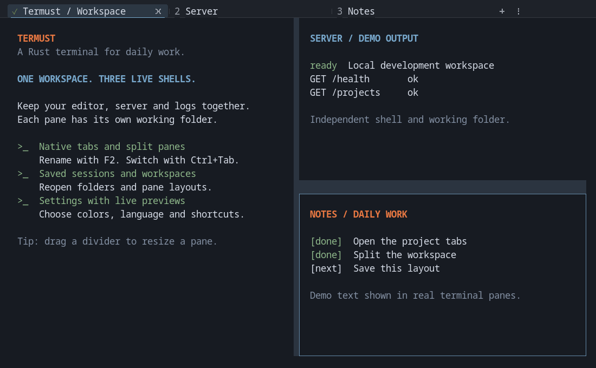
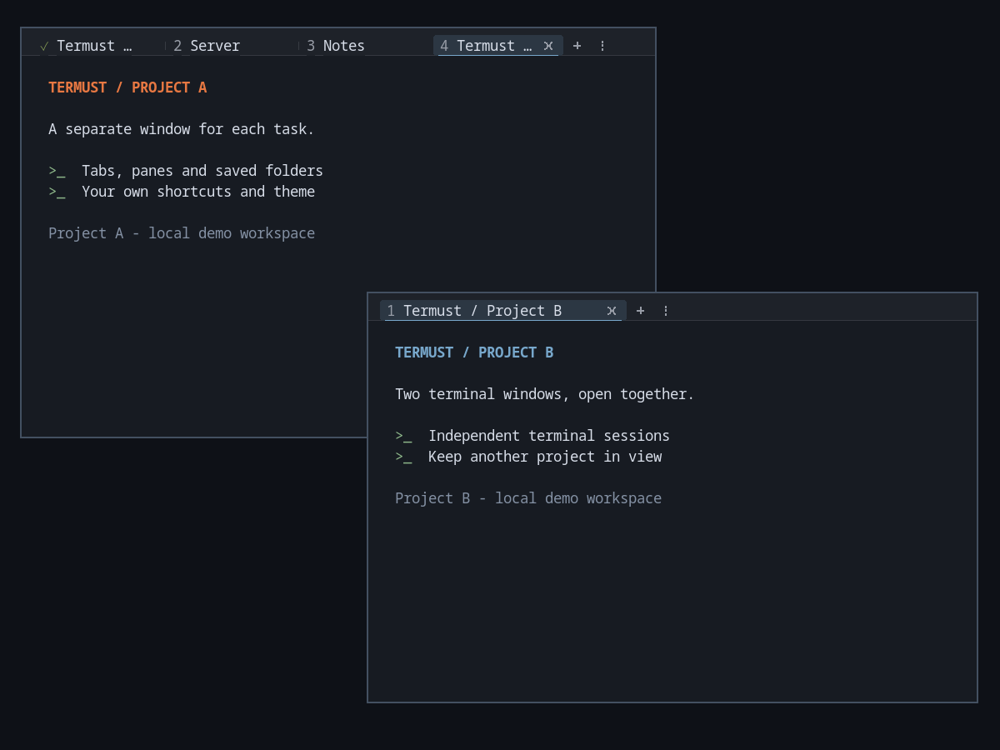
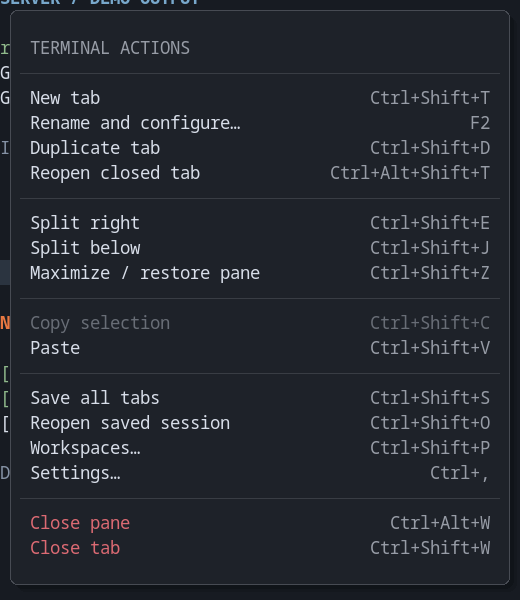
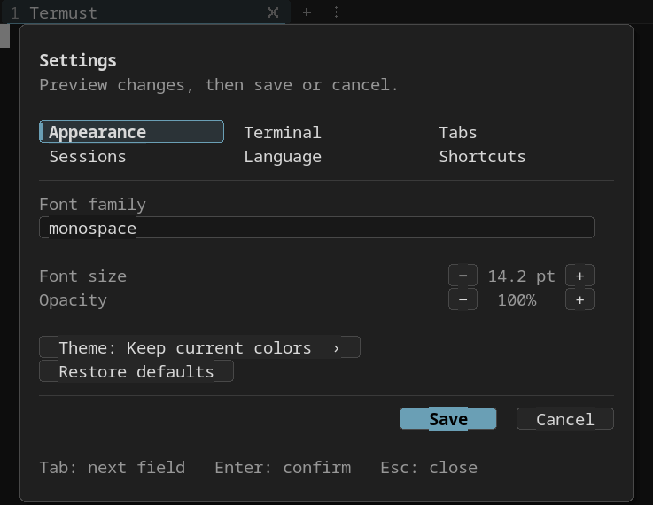
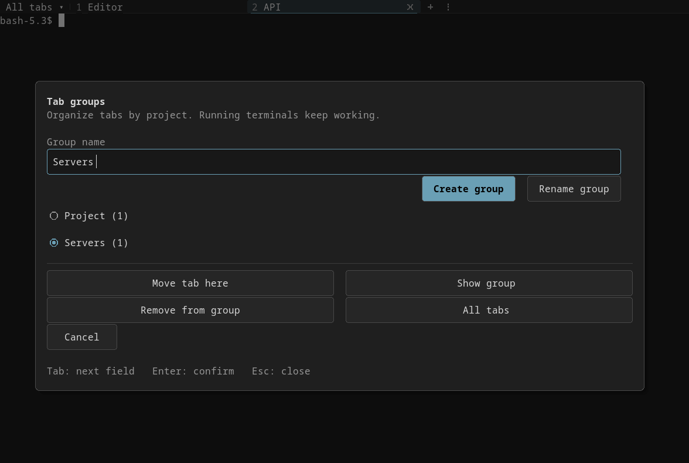
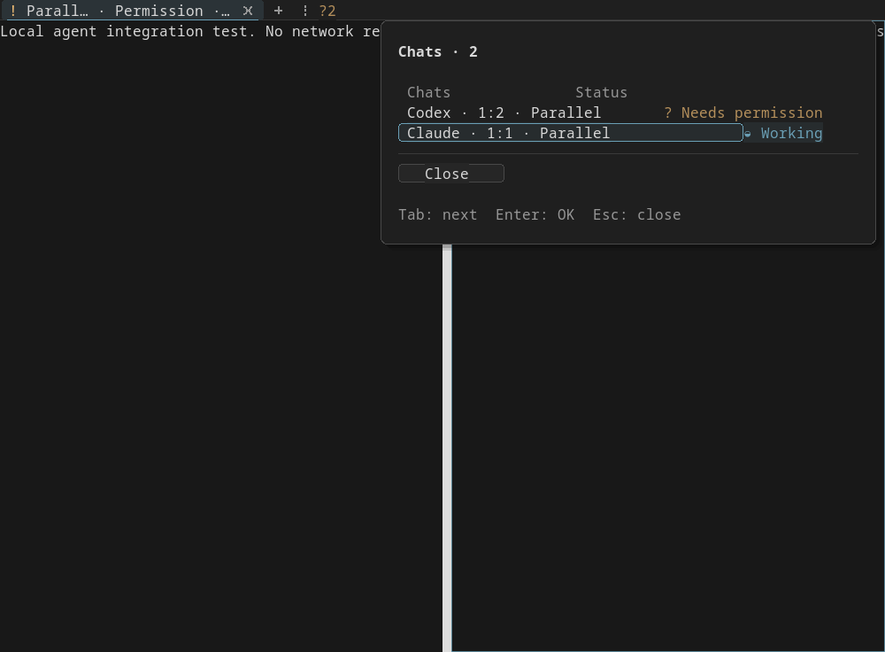

<p align="center">
  
</p>

<h1 align="center">Termust</h1>
<p align="center">A Rust terminal with tabs, split panes and saved workspaces.</p>

Termust is inspired by [Alacritty](https://github.com/alacritty/alacritty)
and built from its Rust code as an independent fork. It keeps that terminal
engine and GPU renderer, and adds tools for daily work in one place.



## Why Termust?

I used Terminator before, but I had performance problems on my computer.
I liked Alacritty's Rust foundation and wanted to keep the tabs, split panes
and easy settings that I use every day. That is why I started Termust.

Parts of this work were developed with AI assistance. Alacritty's
[contribution policy](https://github.com/alacritty/alacritty/blob/master/CONTRIBUTING.md#llmai-contributions)
does not accept AI-generated contributions. We respect that rule, so we did
not open an upstream pull request for these changes. We decided to continue
as Termust, with its own name and features.

We thank the Alacritty authors and contributors for the work that made this
project possible. Termust builds on their work and keeps the upstream credits
and license.

## Tools for daily work

- **Tabs:** open several terminals in one window. Rename with F2, switch with
  Ctrl+Tab, move tabs, duplicate them and reopen a closed tab.
- **Split panes:** work with several shells side by side. Each pane has its own
  shell and working folder. Resize the dividers or maximize the focused pane.
- **Multiple windows:** open several Termust windows at the same time, each
  with its own tabs and shells.
- **Right-click menu:** reach tab, pane, clipboard and session actions quickly.
  Menu labels follow your custom keyboard shortcuts.
- **Tab groups:** put related tabs in named groups and switch between a group
  and all tabs from the compact tab bar.
- **Sessions and workspaces:** save names, groups, folders, pane layouts,
  recent output and the last commands. Optional automatic recovery opens fresh
  shells with this context. Command replay is off by default.
- **Settings:** preview fonts, opacity and themes before saving. Change the
  interface language and find or edit shortcuts in a searchable list. Cancel
  restores the previous look.
- **Languages:** use the interface in English or Brazilian Portuguese.
- **Agents:** follow Claude, Codex, Antigravity CLI and OpenCode from the tabs.
  See when an agent is working, needs a reply or permission, or has finished.
  The [agent overview](docs/agents.md) takes you to its tab and pane.

### Multiple terminal windows



### Menus and settings

| Right-click actions | Compact settings |
| --- | --- |
|  |  |

### Tab groups



### Agent attention



These are real Termust windows on Linux, captured with sample data in an
isolated session. See the [full guide](docs/terminal-tools.md), [tabs](docs/tabs.md),
[panes](docs/panes.md) and [settings](docs/productivity.md) for more details.

## Rust, performance and memory

Termust keeps Alacritty's native Rust terminal engine and GPU rendering.
The goal is to add these daily tools while keeping fast output, responsive
input and low memory use.

Memory use depends on the number of tabs, panes and running applications.
Comparative speed and memory benchmarks have not been published yet.

## Install

Use the same command on Linux x86_64 or macOS Apple Silicon. The installer
detects the platform and downloads its native binary.

```sh
curl -fsSL https://f005.backblazeb2.com/file/termust/install.sh | bash
```

### Linux

The Linux package requires glibc. Release checks cover Ubuntu 22.04/24.04,
Debian 12/13 and Fedora 43/44. See [installation details](docs/install.md)
for requirements, update checks and rollback.

Open **Termust** from your application menu, or run `termust`. Window titles
include the active tab name followed by Termust; saved tab names stay separate.
To build and install this checkout on Linux:

```sh
mise run install
```

### macOS Apple Silicon (experimental)

The installer downloads a native binary without requiring Rust and installs
`~/Applications/Termust.app`. Run the same command again to update; the previous
bundle remains available at `~/Applications/.termust/previous.app`. A basic
launch was tested on macOS 26.6.2; full graphical workflows remain under
validation.

```sh
open ~/Applications/Termust.app
```

## Configuration and existing sessions

Termust looks for `termust/termust.toml` in your configuration directory,
such as `~/.config/termust/termust.toml`. You can also use **Settings** or `Ctrl+,`.

When no Termust configuration exists, it reads the existing Alacritty configuration.
Existing saved tabs, recovery snapshots and workspaces are also available as a
fallback. New session data is stored under `~/.local/state/termust` on Linux.

The internal terminal type remains `alacritty` for compatibility with terminal
applications. Termust and the system Alacritty installation can run side by side.

## Development

```sh
mise exec -- cargo test --workspace
mise run test:shortcuts
mise run test:install
```

Read [CONTRIBUTING.md](CONTRIBUTING.md) before sending a change.
Report Termust issues in [this fork](https://github.com/tarcisiomiranda/alacritty/issues).
The repository keeps its existing URL; the application is now named Termust.

## Logo and license

The original Termust logo combines a copper gear and a terminal prompt.
[SVG, PNG and platform icons](extra/logo) are available with [branding notes](docs/branding.md).

Termust is based on the work of the Alacritty contributors and is distributed
under the [Apache License, Version 2.0](LICENSE-APACHE). Upstream copyright
notices and library attribution are retained.
