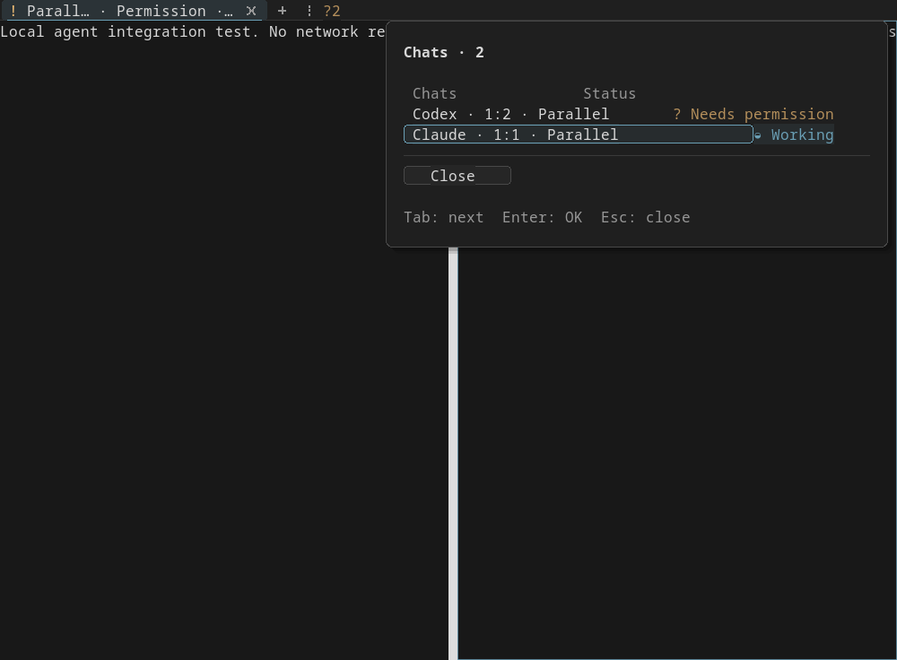

# Agents in Termust

Open a new Termust window and run `claude`, `codex`, `agy` or `opencode` as usual.
A single status icon sits beside the conversation name, leaving the rest of the
label area available for the title.

| Indicator | Meaning |
| --- | --- |
| Blue circle | The agent is thinking or running tools. |
| Yellow `?` | The agent needs an answer or another user action. |
| Yellow `!` | A permission decision is waiting in that terminal. |
| Green `✓` | The agent finished its turn. |
| Red `×` | The agent reported a failure or its process failed. |
| Muted dot | The agent is ready for a prompt. |
| Dotted circle | Detailed status is unavailable. The overview explains limited integration. |

Click the small status-and-count button beside the tab controls to open
**Chats / Conversas** in the upper right. The count includes agent panes across
all tabs, including those hidden by a group filter. The compact list puts
questions and permission requests first, followed by failures, completed turns
and working sessions. Each row shows the provider, tab and pane number, title
and status. Select anywhere on a row to focus that exact tab and split.

The list scrolls when there are many sessions. Arrow keys and Enter also work;
Escape or a click outside closes it. Opening the list or selecting a chat never
answers the agent's question or grants a permission. The same list is available
through **Agents / Agentes** in the right-click menu.

In Animation mode, working circles rotate and reply and permission indicators
pulse. Animation stops when every agent is idle or finished, integration is
disabled, or the window is occluded.

Waiting and completion states remain unread in the background. Opening the
pane acknowledges them. An open agent keeps its current state; finished or
canceled processes stop replacing ordinary shell activity after acknowledgement.
Termust requests window attention when an unattended agent needs you or finishes.
How this appears in the dock or taskbar depends on the desktop.

## Settings

Open **Settings → Agents / Configurações → Agentes** with **Ctrl+,**.
Under **Status indicator / Indicador de estado**, select **Animation / Animação**
or **Static icon / Ícone fixo**, then choose **Save / Salvar**. Animation is the
default. The choice applies to open tabs, the chat count button and the Chats
list. In TOML, set `agent_status_animation = false` under `[general]` for static icons.

Integration and attention notifications are enabled by default. Change the
checkboxes and choose **Save**. Disabling notifications keeps the state visible.
Integration changes apply to new terminal sessions; existing processes keep
running. Disabling integration also hides its indicators immediately.

No global agent settings file needs to be edited. Termust prepares temporary
settings for each terminal session. The command still uses the agent's normal
login, settings, tools and permission policy. Custom aliases or launchers that
skip PATH lookup may need to launch the normal command through PATH to use the
temporary adapter. Absolute-path Codex launches can still supply native events.

## Supported integrations

| Agent | State source | Verified installed version |
| --- | --- | --- |
| Claude Code | Session-local lifecycle hooks, including questions and permission requests | 2.1.316 |
| Codex | Native OSC 7501 events for work, completion, questions and permissions | 0.166.0 |
| Antigravity CLI (`agy`) | Structured title callback state, pending confirmation and task count | 1.4.12 |
| OpenCode | Client-side TUI plugin using session, permission and question/form state | 2.2.5 |

Codex's native events do not need new hooks or hook trust changes. Other Codex
versions that do not emit these events retain ordinary CLI behaviour and have
limited status information. OpenCode's adapter supports the current client
plugin API and a legacy TUI API; headless or incompatible clients may expose
only process completion. Authentication screens can also appear as needing a
reply, because the terminal cannot complete login for the user.

The overview marks limited integration. A quiet terminal is never taken as
proof that the agent is waiting, and output text is not used to guess whether
a tool needs permission. The status is observational: permission decisions
are still made in the agent's own terminal.

## Privacy and lifecycle

The status channel contains provider, state and process/session metadata.
It does not save prompts, responses, tool output or private reasoning. Files
live in a private temporary directory per pane, with owner-only permissions,
and are removed with that pane. Agent status is not restored from a saved
terminal session as if the old process were still running.

This is separate from optional [terminal state saving](productivity.md#automatic-recovery),
which can retain visible terminal text and recent commands. Turning on agent
integration does not turn on that saving option.

## Validation

`mise run test:agents` exercises adapter behaviour and isolated graphical
sessions, including readable tab names in both indicator modes, independent
panes, compact chat lists, group filters, focus, acknowledgement, malformed
events, integration settings and window attention. Tests use sample
data. Real installed OpenCode and Antigravity startup checks run when available.
On macOS, `mise run test:macos-gui` runs the same sample agent through the
Claude proxy, raises a permission request and checks that the overview focuses
that tab.

The optional `scripts/test-codex-agent-native.py --live` sends a small real
Codex request in an isolated graphical session. Its additional `--permission`
check observes and cancels a permission request. These checks need an existing
login and are kept separate from ordinary offline tests.

The initial validation also exercised real Claude completion and a real
Claude permission request without approving the requested command. Claude
questions are covered by the documented hook contract and synthetic event
tests; the headless question probe did not produce an interactive question.
The real OpenCode client emitted ready, working and finished states for one
inert request through the adapter. Antigravity's real structured callback was
verified at startup; its remaining states also have deterministic payload tests.

References: [Claude hooks](https://code.claude.com/docs/en/hooks),
[Codex hooks](https://learn.chatgpt.com/docs/hooks),
[Antigravity title callbacks](https://antigravity.google/docs/cli/title).
