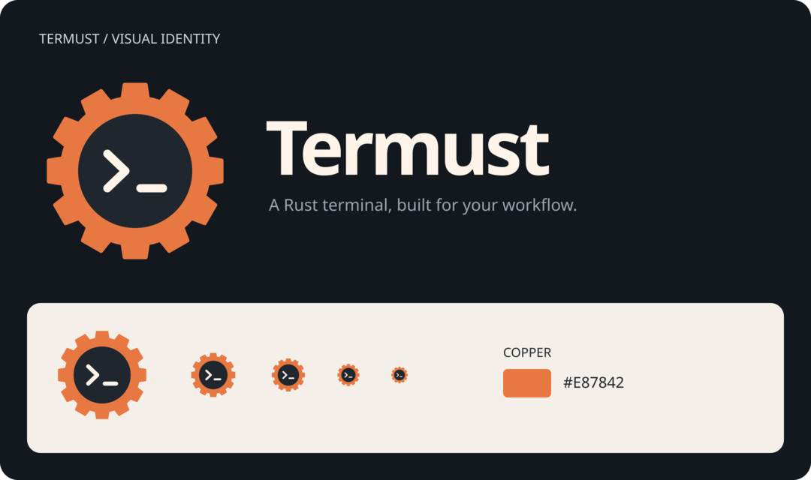

# Termust identity

Termust uses a copper gear with a terminal prompt in its center. The gear and
orange color refer to Rust; the prompt shows the purpose of the application.
The artwork is original and does not use the official Rust logo.



## Assets

- [Scalable icon](../extra/logo/termust.svg) and [256 px transparent PNG](../extra/logo/termust.png).
- [Wordmark for light backgrounds](../extra/logo/termust-wordmark.svg).
- [Wordmark for dark backgrounds](../extra/logo/termust-wordmark-light.svg).
- [Windows ICO](../extra/logo/termust.ico) and [macOS ICNS](../extra/logo/termust.icns).

Use the icon on its own at small launcher sizes. Leave space around the outer
teeth. Keep the prompt readable and preserve the icon's square proportions.
The preview includes 128, 64, 48, 32 and 24 px examples.

The palette uses copper `#E87842`, charcoal `#20262E` and warm white `#FFF4E9`.
The product name is written **Termust**, and the executable is `termust`.

## Regenerate

The SVG is the source artwork. Regenerate the exports with Python and
ImageMagick 7 installed:

```sh
mise exec -- python3 -B scripts/brand-assets.py
mise exec -- python3 -B scripts/verify-branding.py
```

The assets use the repository's Apache-2.0 license. Alacritty's original assets
and copyright notices remain available as part of the upstream source history.
