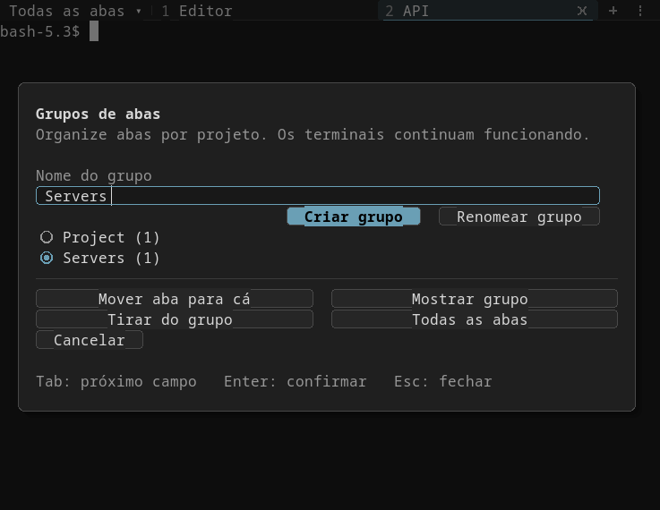

# Terminal tabs

This version supports independent terminal sessions in one window on Linux,
macOS, BSD and Windows. Each tab keeps its own shell, scrollback, selection and
search. Sessions continue running while another tab is selected. On macOS the
Termust tab bar replaces the system window tabs, so tabs, groups and panes work
the same way as on Linux.

| Shortcut | Action |
| --- | --- |
| Ctrl+Shift+T | Create a tab |
| Ctrl+Shift+W | Close the active tab |
| F2 / Ctrl+Shift+R | Rename the active tab and open its settings |
| Ctrl+Shift+S | Save all tabs in the current window |
| Ctrl+Shift+O | Reopen the saved tabs in the current window |
| Ctrl+Shift+D | Duplicate the active tab |
| Ctrl+Shift+Alt+T | Reopen a recently closed tab |
| Ctrl+Shift+PageUp / PageDown | Move the active tab |
| Ctrl+Shift+P | Manage named workspaces |
| Ctrl+, | Open settings |
| Ctrl+Shift+Tab / Ctrl+PageUp | Select the previous tab |
| Ctrl+Tab / Ctrl+PageDown | Select the next tab |
| Alt+1 through Alt+8 | Select a numbered tab |
| Alt+9 | Select the last tab |

On macOS the same actions use Command:

| Shortcut | Action |
| --- | --- |
| Cmd+T | Create a tab |
| Cmd+W | Close the active tab |
| F2 / Shift+Cmd+R | Rename the active tab and open its settings |
| Shift+Cmd+S | Save all tabs in the current window |
| Shift+Cmd+O | Reopen the saved tabs in the current window |
| Shift+Cmd+D | Duplicate the active tab |
| Shift+Cmd+T | Reopen a recently closed tab |
| Shift+Cmd+PageUp / PageDown | Move the active tab |
| Shift+Cmd+P | Manage named workspaces |
| Cmd+, | Open settings |
| Ctrl+Shift+Tab / Shift+Cmd+[ | Select the previous tab |
| Ctrl+Tab / Shift+Cmd+] | Select the next tab |
| Cmd+1 through Cmd+8 | Select a numbered tab |
| Cmd+9 | Select the last tab |
| Cmd+N | Open a new window |
| Cmd+Q | Quit Termust after one confirmation for every window |

Inside Termust dialogs, Cmd+A, Cmd+V and Cmd+Enter work like their Ctrl
counterparts.

Cmd+Q and **Quit Termust** in the application menu show one confirmation with
the number of open tabs and windows. **Confirm before closing a tab** controls
this dialog too; with it turned off, Cmd+Q quits immediately. When automatic
recovery is on, the focused window's tabs are saved before Termust quits.
With `window.decorations = "Transparent"` or `"Buttonless"`, the tab bar starts
below the strip that holds the window buttons, so clicks there keep moving the
window.

F2 opens tab settings at the shell prompt. Applications using the alternate
screen, such as terminal editors and process monitors, keep their F2 key;
use Ctrl+Shift+R to rename while they are open. The old shortcuts still work.
Change or disable tab shortcuts in **Settings → Shortcuts**. Context menus show
the effective shortcut, including custom bindings and the terminal's current mode.

Click a tab to select it, `+` to create one, or `×` to close one. Middle-clicking
a tab also requests closure. By default, a confirmation shows the tab name:
**Y** or **Enter** closes it; **N** or **Escape** cancels. Mouse buttons also
confirm or cancel, including for the final tab. Disable the prompt through
**Settings → Tabs**, or set
`general.confirm_tab_close = false`. Right-click the terminal or tab bar, or click `⋮`, to open
the grouped context menu. It offers tab creation and organization, split panes,
clipboard actions, saved sessions, workspaces, settings and closing actions.
Use the mouse or Up/Down and Enter to choose an action. In compact windows,
scroll with the wheel or the arrow controls; Home/End and PageUp/PageDown also
navigate the menu. Escape or a click outside closes it. Disabled actions and
separators keep the menu open. When a terminal application handles the mouse,
use Shift+right-click to open the menu.

The compact tab bar reserves one text row. Rounded tabs use a subtle selected
background and a thin accent underline. Long titles use an ellipsis. Hovering
highlights a tab and reveals its close button; the active tab always shows its
close button. The close target sits inside the tab with a margin on the right.
Running, completed and failed command indicators use separate colored badges.

Menus, dialogs and tabs share the terminal theme. Surfaces and text derive from
`colors.primary.background` and `colors.primary.foreground`; highlights use
`colors.normal.blue`, and destructive actions use `colors.normal.red`. A theme
can assign any color to these slots. Changes apply on configuration reload.
Text over filled accent buttons automatically uses black or white for contrast.

When the bar is too narrow to show every tab, it keeps the active tab visible;
keyboard shortcuts still reach all sessions. Drag tabs to reorder them.
See [settings, workspaces and recovery](productivity.md) for the additional
native controls and background command activity markers.

New tabs use the configured shell and inherit the active session's working
directory when the platform supports it. Shell variables remain independent.
Exiting a shell closes its tab. Closing the last tab closes the window.
`--hold` applies to the session created with that option. Closing the window
or using `Quit` closes all its sessions.

The actions `CreateNewTab`, `CloseTab`, `SelectNextTab`, `SelectPreviousTab`,
`SelectTab1` through `SelectTab9`, `SelectLastTab`, `RenameTab`, `SaveSession`
and `RestoreSession` can be assigned through
the existing `keyboard.bindings` configuration.

## Tab groups

Choose **Tab groups / Grupos de abas** in the right-click menu. Enter a name
and choose **Create group** to put that tab in a new group. The group selector
then appears at the left of the tab bar, without adding another row.

Click the selector to show one group or **All tabs / Todas as abas**. The group
dialog also lets you rename a group, move the target tab into another group,
or remove it from its group. Groups have unique names of up to 64 characters.
An empty group disappears; its other tabs keep running when you switch views.

New tabs inherit the active group. When one group is shown, next/previous tab,
Alt+number and keyboard reordering apply to that group's tabs. Showing all tabs
restores navigation across the whole window. Dragging keeps each tab's group.
Saved sessions, workspaces and automatic recovery keep membership and the
selected group together with tab order and the active tab.



## Interface language

Choose **Settings… / Configurações…** in the context menu, then open **Language /
Idioma**. Select **Automatic (system) / Automático (sistema)**, **English**, or
**Português (Brasil)**, then choose **Save / Salvar**. The choice
applies to every open window immediately, including open menus, tab dialogs, search bars and session
notices. Message truncation indicators also follow the interface language.

The setting lives in the TOML configuration:

```toml
[general]
language = "auto"
```

The supported values are `"auto"` (the default), `"en"` and `"pt-BR"`. English
and Brazilian Portuguese are the currently available interface translations.
Automatic detection uses the first nonempty `LC_ALL`, `LC_MESSAGES` or `LANG`.
For a base locale other than `C` or `POSIX`, the first supported entry in
`LANGUAGE` takes precedence. `C` and `POSIX` use English. Without a supported
preference, unsupported locales also use English. Windows uses its native user
locale when no environment preference is available.

Saving persists the selected preferences in the active primary TOML file with an
atomic write; comments, imports, unrelated settings and file permissions are
preserved. If no configuration exists, the dialog creates
`$XDG_CONFIG_HOME/termust/termust.toml` on Unix, falling back to
`~/.config/termust/termust.toml`, or
`%APPDATA%\termust\termust.toml` on Windows. An unwritable file or legacy YAML
configuration shows an error and keeps the previous language and file.

An explicit saved choice replaces the current language override from
CLI or IPC while preserving other overrides. A later explicit override can
still select a language. Editing `general.language` and reloading the
configuration also updates open menus and dialogs. Shell locale and output,
tab names, paths and command text keep their existing values.

## Names and saved sessions

Choose the tab name and settings action in the context menu, or press
Ctrl+Shift+R, to open the settings dialog. Edit the highlighted name field and
choose **Apply / Aplicar**. A custom name remains in place when the shell changes
its title. Clear the name to return to the shell title. Click the checkbox or a
button to change settings; buttons highlight when the pointer is over them.
Tab and Shift+Tab move between controls, Space changes the checkbox, and Enter
activates a control. Escape or a click outside dismisses the dialog without
applying edits.

**Save all tabs / Salvar todas as abas** saves the current window's tab order,
active tab, names, working directories, original shell profiles, up to 20 recent
executed commands per tab, and each tab's replay preference. Save again after
changes you want to
keep. Closing tabs leaves the saved snapshot intact. A normal launch restores
it; an explicit command, directory, title, `--hold`, or a reference test keeps
its requested startup behavior. **Reopen saved session / Reabrir sessão salva**
adds the saved tabs to the current window.

The **Run the last command when reopening / Executar o último comando ao reabrir**
checkbox is off by default. It requires an integrated shell and a captured
command. When selected and saved, the last command runs once after the restored
shell is ready, from its original
execution directory. If that directory no longer exists, execution is skipped
with a notice. Unchecking the option and applying or saving cancels execution
that is still waiting for shell readiness. A failed saved shell starts a normal
terminal with a notice;
the saved file is retained.

Commands are captured using Bash, Zsh and Fish lifecycle hooks. Supported
interactive shell profiles are saved so replay uses the same shell. Custom
command or script arguments and login-shell profiles are left untouched and
have no command capture or replay. Only commands executed in the tab after its
creation are captured; no global history or raw keyboard input is read. Bash
history exclusions and disabled history are respected. The dialog shows the
last three captured commands. Process state, scrollback and unsaved shell
variables are not restored.

The snapshot is written atomically to `$XDG_STATE_HOME/termust/tabs.json`,
falling back to `~/.local/state/termust/tabs.json` on Unix, and to
`%LOCALAPPDATA%\termust\tabs.json` on Windows. Unix files are private to the
current user (0600); newly created state directories and temporary shell
metadata directories use 0700. The saved file contains command text; shell
history exclusions can prevent selected commands from being captured.

## Running this checkout

To build and open this checkout:

```sh
mise exec -- cargo run -p termust
```

The installed system binary is separate from this checkout.

## Verification

```sh
mise exec -- cargo test --workspace
mise exec -- cargo build -p termust
mise exec -- python3 scripts/test-tabs.py
mise exec -- python3 -B scripts/test-tab-sessions.py
mise exec -- python3 -B scripts/test-tab-ui.py
mise exec -- python3 -B scripts/test-language.py
mise exec -- python3 -B scripts/test-productivity.py
```

The graphical test runs in a temporary Xvfb display. It requires Linux, Xvfb,
libX11, libXtst, Bash and Python. It checks independent processes and variables,
working directory inheritance, input immediately after a tab switch,
background terminal query replies, resizing all PTYs, keyboard and mouse
controls, background session exit, and per-session hold behavior. Pass a binary
path to test another build, or `--screenshot PATH.png` to capture the bar using
ImageMagick. The session test additionally checks renaming, private snapshot
permissions, original working directories, ordered restoration, saved shell
profiles, replay preferences, selected execution, corrupt files, and startup
CLI overrides. Bash capture and replay also have real PTY unit tests; Zsh and
Fish integration scripts are unit-tested but were not run locally because
those shells were unavailable. The language test checks locale detection,
persistent interface choices, configuration preservation and shell continuity.
