# Tabs, panes and daily work

This fork adds tools for daily work in one window. These changes are for this
fork. Alacritty upstream has different goals and does not accept native tabs or
split panes.

I used Terminator before. It was slow on my computer. Terminator uses Python.
I liked the idea of a terminal written in Rust, so I tried Alacritty. I wanted
to keep the tabs and split panes that I use every day. This is why I started
these changes. This is my own experience, not a speed test.

## Tabs

Each tab has its own shell, history and working folder. You can give it a name,
move it with the mouse, make a copy and reopen a closed tab. Long names use an
ellipsis. The close button has space around it.

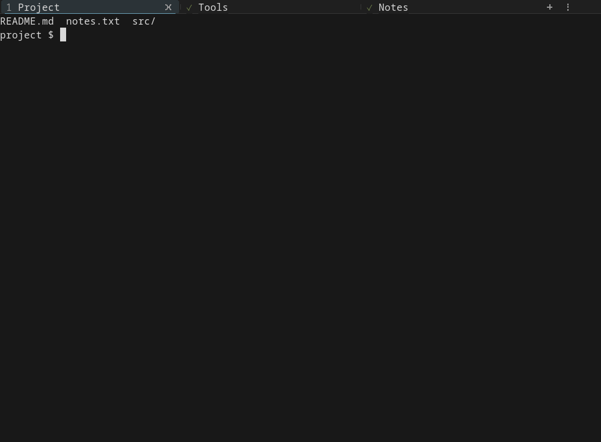

## Split panes

Split a tab to the right or below. Each pane has its own shell. Move focus with
the keyboard or mouse. Drag the border to change the size. You can also make
one pane fill the tab and then go back to the full layout.

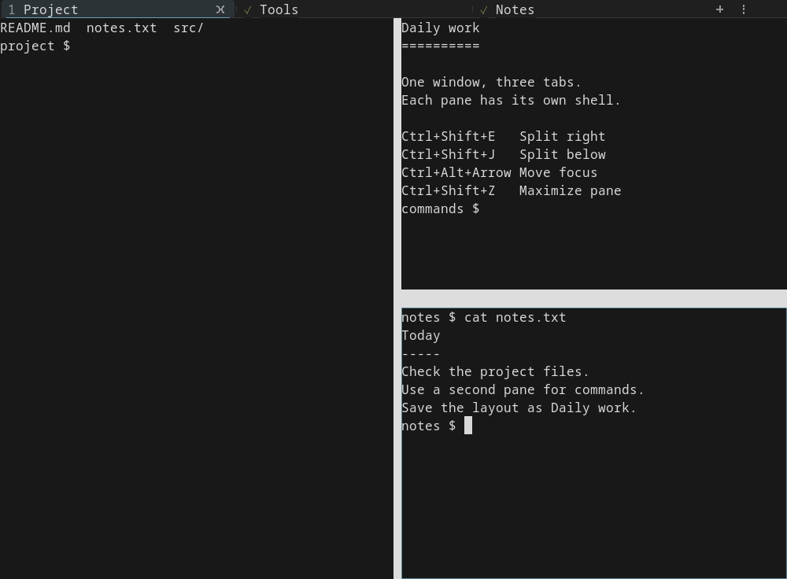

## Right-click menu

The menu gives quick access to tabs, panes, saved sessions and settings. It
also works with the keyboard. In a small window, it can scroll.

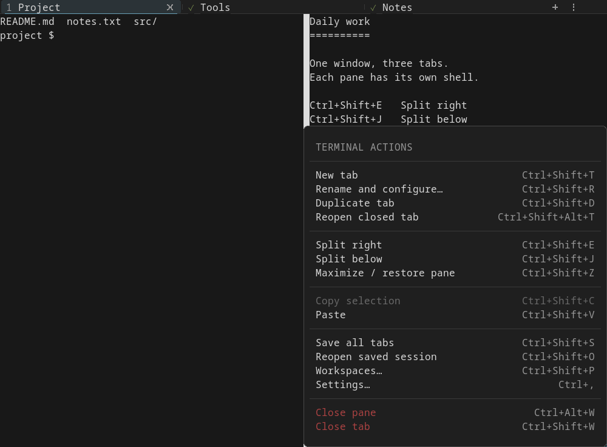

## Tab names and saved commands

The tab dialog shows the name, working folder and recent commands. It can
save all tabs. Running the last command again is off by default. Turn it on
only for the tabs where you want this behavior.

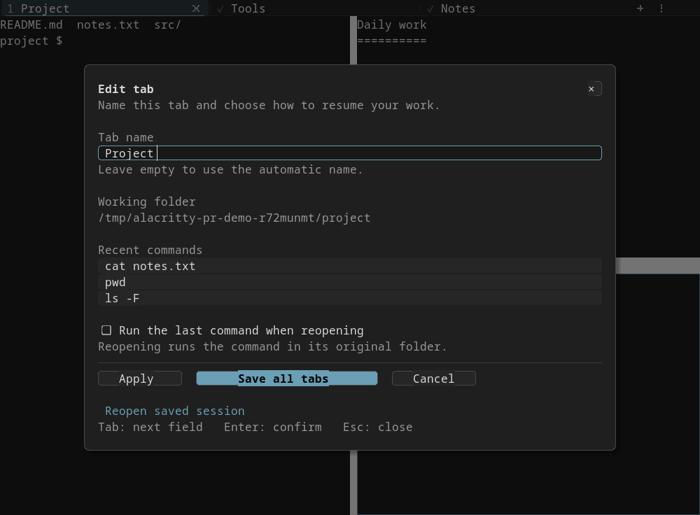

## Close confirmation

Before a tab closes, you can check its name. Press **Y** or **Enter** to close
it. Press **N** or **Escape** to cancel. You can turn this option off in settings.

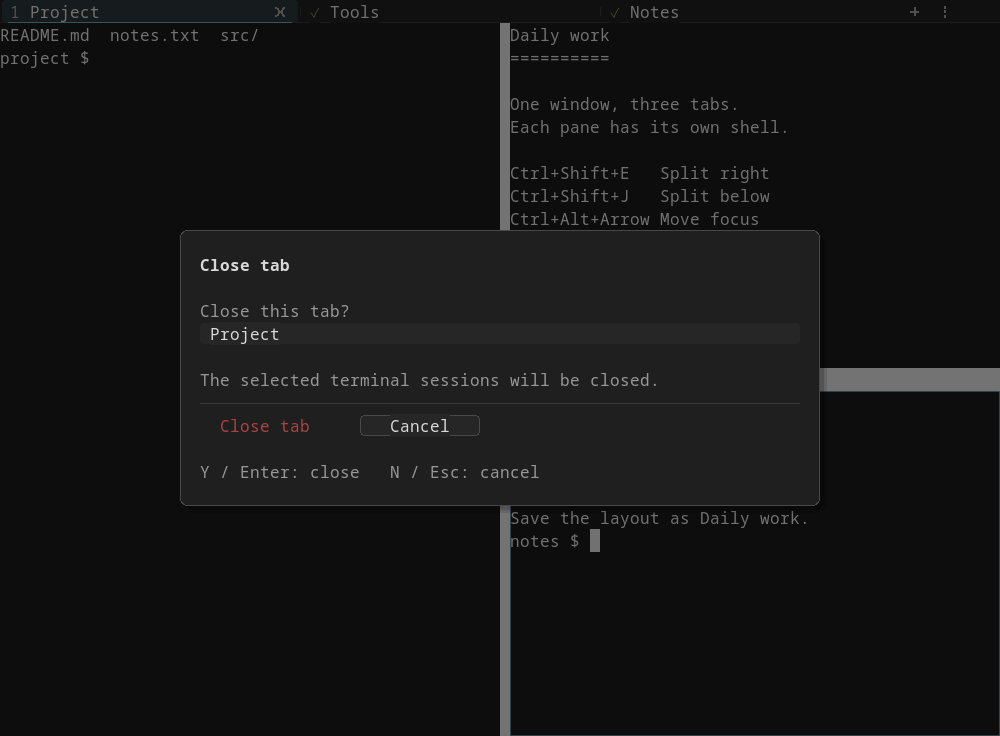

## Workspaces and sessions

Save a group of tabs and panes with a name, such as **Daily work**. Open it
later with its folders and layout. Session settings also control startup and
recovery.

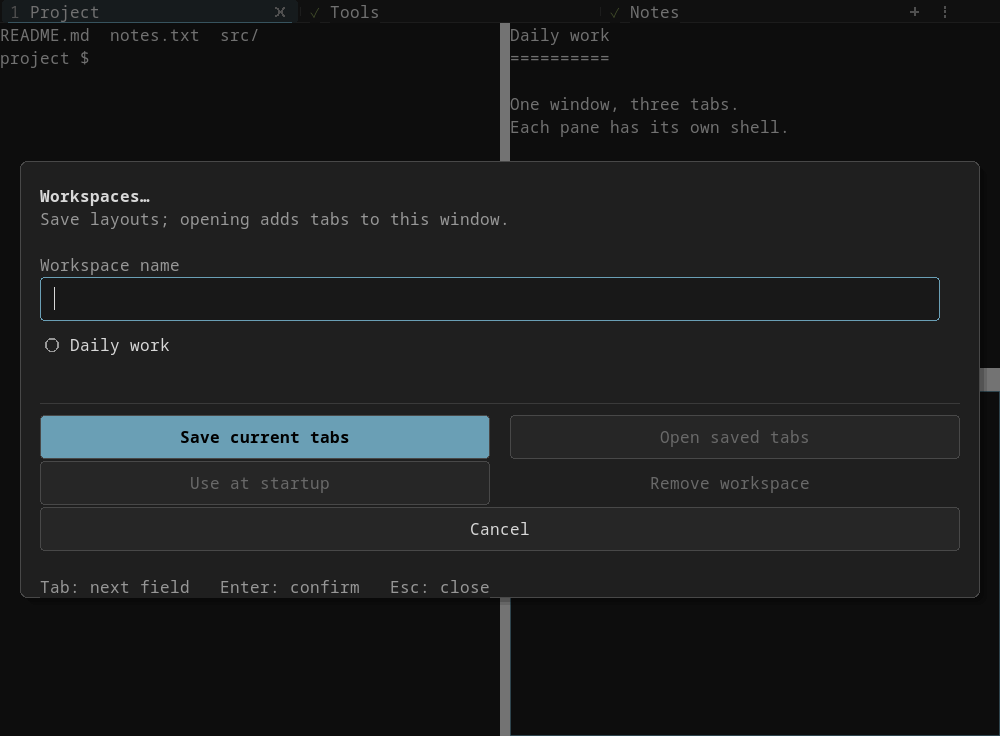

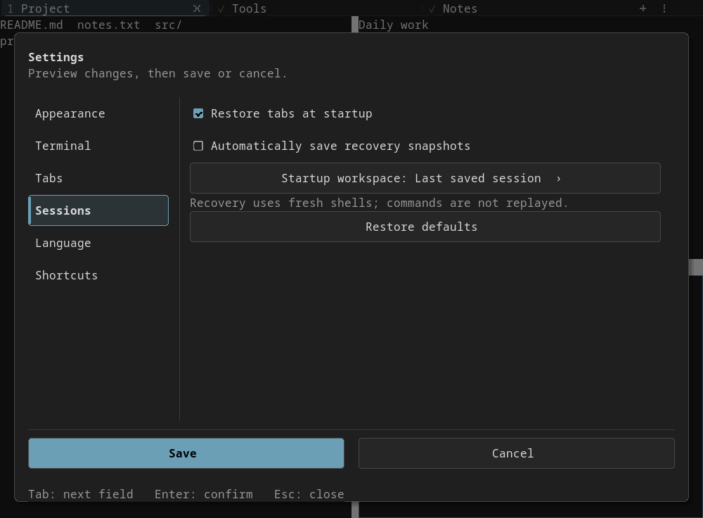

## Settings and themes

Change settings with a live preview. Save keeps the change. Cancel brings back
the old value. Tabs, menus and settings use the terminal colors. Light and dark
themes both work.

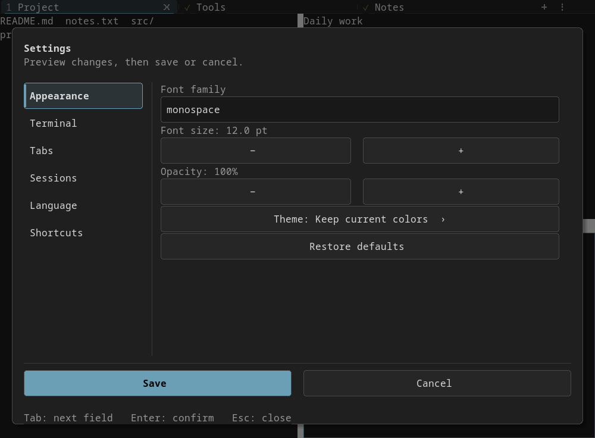

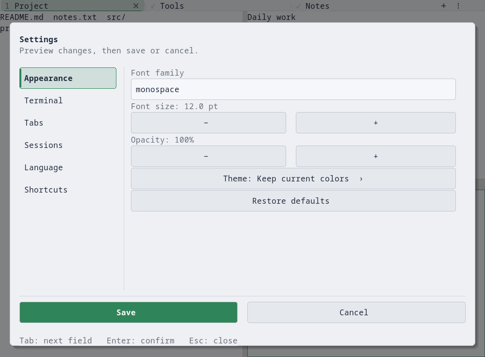

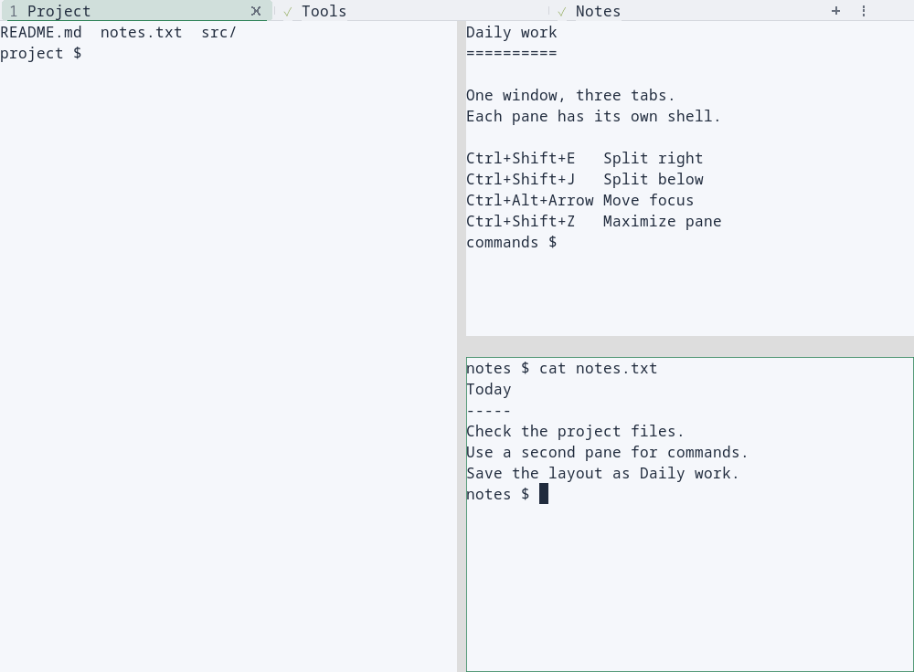

## Language

Choose the system language, English or Brazilian Portuguese. The choice is
saved. It changes the interface, while shell output keeps its own language.

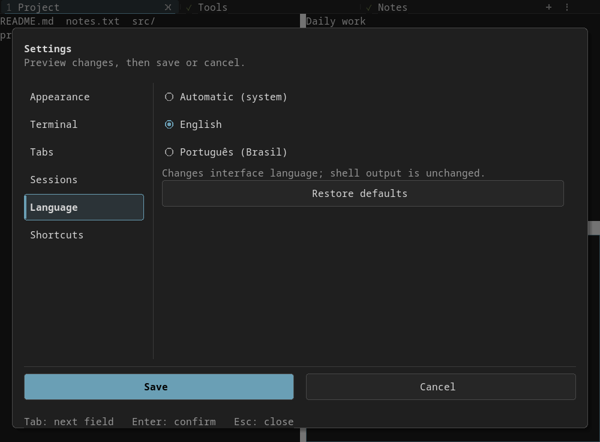

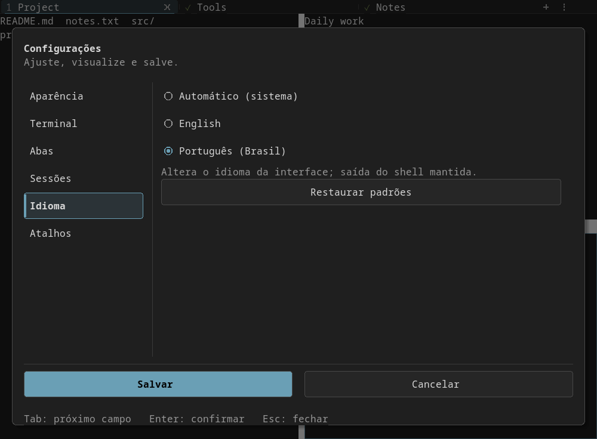

## Shortcuts

See and change shortcuts in settings. The editor checks for conflicts before
you save a new key.

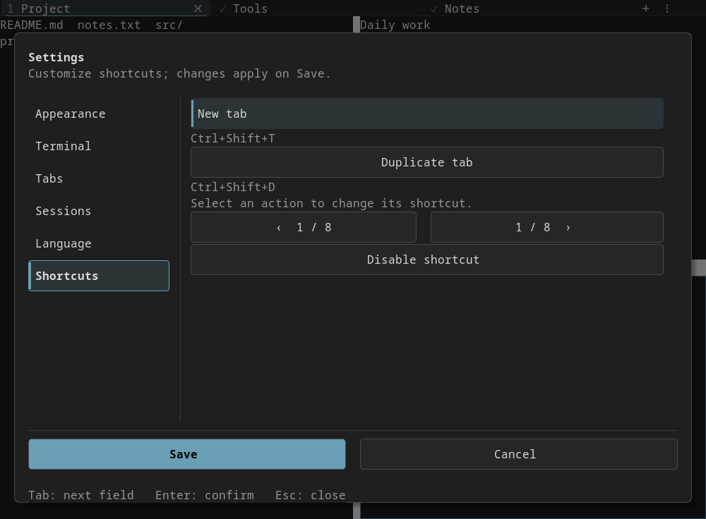

See [tabs and saved sessions](tabs.md), [split panes](panes.md) and
[settings and workspaces](productivity.md) for the keys and full details.

## Tests

The screenshots above come from the actual app on Linux/X11, using a temporary
Xvfb display and sample files. They do not show private sessions. The Rust
workspace tests pass on stable Rust and Rust 1.85.0. Graphical tests cover tabs,
panes, sessions, menus, settings, language and close confirmation. This is not a
speed comparison with Terminator. Windows and macOS have not been tested here.
